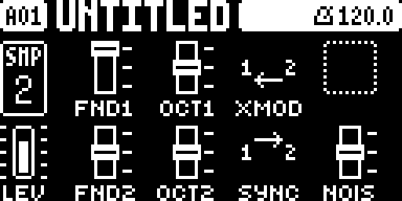

# OB-1 for the Digitakt

An Oberheim OB-1 oscillator section as a sample-track machine for the Digitakt mk1. It's an SRC machine,
added to the OS by [elekloader](https://github.com/irpina/elekloader). Pick OB-1 as a track's machine and
its SRC page plays two analog-style VCOs instead of a sample. The track's filter, envelopes, LFOs, level
and sends work on it as they do on a sample.

- **Two VCOs.** Each has the OB-1's two waveshapes:
  - **saw type**, from triangle to sawtooth;
  - **pulse type**, from a narrow pulse to a square;
  - a **sub-octave** square.
- **Hard sync** (VCO2 to VCO1) and **cross mod** (VCO2's saw sweeping VCO1's pitch, about ±3.92 octaves).
- **A noise source.**
- **The OB-1's mixer:** VCO1, VCO1 OCT, VCO2, VCO2 OCT and NOISE, each ON, −3 dB or OFF as on the panel, AC-coupled.
- **Reduced aliasing** with polyBLEP and polyBLAMP corrections, with [limits at high pitches and under sync](docs/dsp.md#band-limiting).
- **Two SRC pages** with fifteen controls: oscillator tuning and shaping on the first, mixer and routing on the second.
- **Display graphics** showing waveform shapes, tuning and routing, with vertical three-position switches for output levels.

Built for OS 1.53 and 1.54. It's machine id 69.

Digitone support is [scaffolded](machines/digitone/README.md); its build tasks are placeholders.

## Install

You need the stock Digitakt mk1 OS file from Elektron: `Digitakt_OS1.54.syx` (or 1.53's, with `ELEKLOADER_STOCK`
in `mise.toml` pointed at it). The build patches it, and only its main OS section changes. You also need macOS or Linux with [mise](https://mise.jdx.dev).

```sh
mkdir -p firmware
cp ~/Downloads/Digitakt_OS1.54.syx firmware/
mise bootstrap        # the m68k toolchain, tools, submodules, the emulator's dependencies
mise run firmware     # builds everything and writes out/Digitakt_custom.syx
```

### Flash it

With Elektron Transfer, as for any OS update ([elekloader's steps](https://github.com/irpina/elekloader/blob/main/docs/BUILDING.md#flash-it)):

1. Connect the Digitakt over USB and open Transfer.
2. Select the unit and **Connect**.
3. Drag `out/Digitakt_custom.syx` onto **Drop files here**.
4. Press **YES** on the unit, and don't power it off until it has written the OS and restarted.

### If it won't start

The bootloader is never changed, so the stock OS always restores the unit. Hold **FUNC** while powering on,
press **TRIG 4** for **OS UPGRADE**, and send the stock file with Transfer's legacy OS upgrade mode.

## Playing it

On a track's SRC page, open the machine menu (**FUNC + SRC**) and pick **OB-1**. A track switched to OB-1
starts as two sawtooths in unison: VCO1's fundamental ON, VCO2's at −3 dB, everything else OFF.

The first SRC page puts both oscillators' performance controls together: VCO1 on the top row,
VCO2 on the bottom row. Press **SRC** to switch to the mixer and routing page; press it again to return.
Knobs A–D control the top row and E–H the bottom row. The mixer page leaves knob D unused.

| Page 1 — Oscillators | Page 2 — Mixer and routing |
|---|---|
|  |  |

Captured directly from a Digitakt mk1 running OB-1. The settings shown are examples, not the defaults.

| Knob | Page 1 — Oscillators | Page 2 — Mixer / routing |
|---|---|---|
| A | **FRQ1** — VCO1 coarse tuning | **FND1** — VCO1 fundamental level |
| B | **FIN1** — VCO1 fine tuning | **OCT1** — VCO1 sub-octave level |
| C | **TYP1** — VCO1 saw / pulse family | **XMOD** — cross modulation OFF / ON |
| D | **WAV1** — VCO1 waveform shape | Blank |
| E | **FRQ2** — VCO2 coarse tuning | **FND2** — VCO2 fundamental level |
| F | **FIN2** — VCO2 fine tuning | **OCT2** — VCO2 sub-octave level |
| G | **TYP2** — VCO2 saw / pulse family | **SYNC** — hard sync OFF / ON |
| H | **WAV2** — VCO2 waveform shape | **NOIS** — noise level |

Each oscillator tunes independently from the played note: coarse tuning spans −32 to +31 semitones,
and fine tuning spans −50.0 to +50.0 cents. **TYP1/TYP2** select **SAW** or **PULS** independently.
**WAV1/WAV2** span 0–63 within the selected family: triangle to saw for SAW, narrow pulse to square
for PULS. Sweeping WAV never switches family. The waveform pictures follow both the family and shape,
including the values shown while editing held-step locks.
Fundamental, sub-octave and noise levels use vertical three-position switches: ON at the top,
−3DB in the middle, OFF at the bottom.

The parameter mapping replaces earlier builds without migration. Sounds saved by this build use
machine-pages' version-4 format and require compatible custom firmware to reload.

Some things to try:

- **Sync sweep:** SYNC ON, VCO2 alone, then sweep FRQ2 or put an LFO on it.
- **Bells and gongs:** XMOD ON with VCO2 a few octaves down. That's what the OB-1's manual suggests cross mod for.
- **A fat unison:** both fundamentals ON, FRQ1 and FRQ2 at +0, then detune FIN2 by a few cents and add the subs to taste.

Notes and mixer switches do not reset oscillator phase. Both VCOs and their sub-octaves keep running
while the voice is active, including when their outputs are OFF.

### Voices and CPU

Each sounding OB-1 voice costs DSP time on top of the stock engine.

Both oscillators run for every active voice, even when one or both mixer outputs are OFF. Selected
sync and cross modulation also keep running while muted, so muting a source does not reclaim its CPU
cost. Waveform and routing choices still affect the work per voice.

See the [matched CPU-cost comparison](docs/performance.md#continuous-muted-oscillators) for measurements.
`mise run bench` counts ColdFire instructions for the DSP alone; it does not measure complete firmware
timing or establish a safe voice count. Leave headroom and check the intended sound on the device.
See [benchmark interpretation](docs/development.md#benchmark-interpretation).

## How faithful it is

The model follows the OB-1's oscillator topology, with saw-family shape/level, cross-modulation depth,
mixer steps and white-noise output calibrated against OB-2 by KBPlugs. Both mixer middle positions
are approximately −3 dB. The minimum pulse width remains provisional at 6.7 %; drift and other analog
variation are omitted. Agreement with the reference plugin is distinct from validation against a
physical OB-1, for which no controlled capture set is included.

[Sources and confidence](docs/references.md) separates printed facts, calculations, measurements and
model choices. [The DSP reference](docs/dsp.md) explains the sound and its approximations.

## Technical documentation

- [Architecture](docs/architecture.md): signal flow, device boundaries, parameter encoding and saved sounds.
- [DSP](docs/dsp.md): numeric formats, waveforms, modulation, mixing and approximation limits.
- [Development](docs/development.md): setup, commands, verification, benchmarks and releases.
- [Sources and confidence](docs/references.md): manuals, schematics, derivations and unresolved questions.

For host-only work, start with `mise run test`; stock firmware and the cross-toolchain are not needed.

## License

GPL-2.0-or-later.
