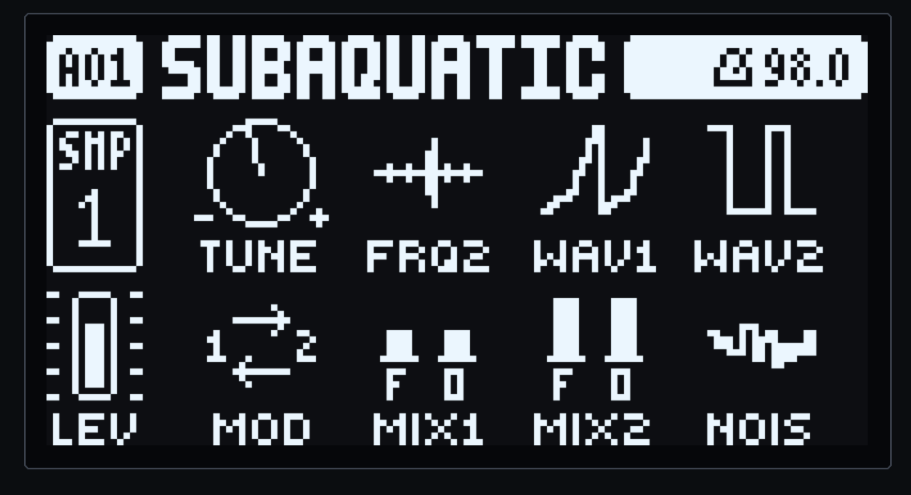

# OB-1 for the Digitakt



An Oberheim OB-1 oscillator section as a sample-track machine for the Digitakt mk1. It's an SRC machine,
added to the OS by [elekloader](https://github.com/irpina/elekloader). Pick OB-1 as a track's machine and
its SRC page plays two analog-style VCOs instead of a sample. The track's filter, envelopes, LFOs, level
and sends work on it as they do on a sample.

- **Two VCOs.** Each has the OB-1's two waveshapes:
  - **saw type**, from triangle to sawtooth;
  - **pulse type**, from a narrow pulse to a square;
  - a **sub-octave** square.
- **Hard sync** (VCO2 to VCO1) and **cross mod** (VCO2's saw sweeping VCO1's pitch, ±5 octaves).
- **A noise source.**
- **The OB-1's mixer:** VCO1, VCO1 OCT, VCO2, VCO2 OCT and NOISE, each ON, −3 dB or OFF as on the panel, AC-coupled.
- **Band-limited** with polyBLEPs, so high notes, sync sweeps and pulses stay clean.
- **Knob graphics** that show each setting: the waveform, the interval, the routing, the mix.

Built for OS 1.53. It's machine id 120, in elekloader's experiments range (120–127).

## Install

You need the stock Digitakt mk1 OS 1.53 file, `Digitakt_OS1.53.syx`, from Elektron. The build patches it,
and only its main OS section changes. You also need macOS or Linux with [mise](https://mise.jdx.dev).

```sh
cp ~/Downloads/Digitakt_OS1.53.syx firmware/
mise bootstrap        # the m68k toolchain, tools, submodules, the emulator's dependencies
mise run firmware     # builds everything and writes out/Digitakt_custom.syx
```

### Flash it

Over USB, from this repo:

1. Connect the Digitakt over USB.
2. Hold **FUNC** while powering it on, then press **TRIG 4** for **OS UPGRADE**.
3. Run `mise run flash`. It builds the firmware, finds the Digitakt's MIDI port, and sends the file after you confirm.
4. Don't power the unit off until it has written the OS and restarted.

`mise run flash --port NAME` picks another MIDI output, `--delay MS` changes the pause between SysEx messages
(default 10, about 2 minutes in all), and `--yes` skips the question.

You can also flash with Elektron Transfer, as for any OS update: connect, then drop
`out/Digitakt_custom.syx` onto it.

### If it won't start

The bootloader is never changed, so the stock OS always restores the unit. Hold **FUNC** while powering on,
press **TRIG 4**, and send the stock file, with Transfer's legacy OS upgrade mode or with:

```sh
uv run --with mido --with python-rtmidi python tools/upload.py firmware/Digitakt_OS1.53.syx
```

## Playing it

On a track's SRC page, open the machine menu (**FUNC + SRC**) and pick **OB-1**. A track switched to OB-1
starts as a single sawtooth: VCO1's fundamental ON, everything else OFF.

| Knob | Name | Values | What it does |
|---|---|---|---|
| A | TUNE | as a sample's | VCO1's pitch against the trig's note |
| B | FRQ2 | −32 to +31 | VCO2, in semitones from VCO1 |
| C | WAV1 | S0–S63, P0–P63 | VCO1's waveshape: S is saw type (S0 triangle, S63 saw); P is pulse type (P0 a 6.7 % pulse, P63 a square) |
| D | WAV2 | S0–S63, P0–P63 | VCO2's waveshape, as WAV1 |
| E | MOD | OFF, SYNC, XMOD, BOTH | VCO2 hard-synced to VCO1, VCO1 cross-modulated by VCO2's saw, or both |
| F | MIX1 | FUND/OCT, each ON, -3 or - (OFF) | VCO1's fundamental and sub-octave in the mix |
| G | MIX2 | FUND/OCT, each ON, -3 or - (OFF) | VCO2's, as MIX1 |
| H | NOIS | OFF, -3DB, ON | Noise in the mix |

Some things to try:
- **Sync sweep:** MOD on SYNC, VCO2 alone, then sweep FRQ2 or put an LFO on it.
- **Bells and gongs:** MOD on XMOD with VCO2 a few octaves down. That's what the OB-1's manual suggests cross mod for.
- **A fat unison:** both VCOs ON, with FRQ2 at +0 or +12, and the subs added.

Both VCOs run freely between notes, as the OB-1's do, so each note starts at a different phase.

### Voices and CPU

Each sounding OB-1 voice costs DSP time on top of the stock engine. A voice whose amp envelope has finished
costs nothing.

| Sound | Fits at once |
|---|---|
| One VCO (the default saw) | about 8 voices |
| Both VCOs and their subs | about 6 voices |
| Heavy: both VCOs with sync, cross mod and noise | **about 4 voices** |

More than that overloads the unit. Measured with `mise run bench`, which counts the DSP's ColdFire
instructions per 32-sample block for 8 voices, against the stock engine's measured 80 % of a block:

| Setting | Instructions a block | A voice | 8 voices, of a block |
|---|---|---|---|
| default: one saw | 15,554 | 1,944 | +15 % |
| both VCOs and subs | 24,090 | 3,011 | +23 % |
| heavy: + SYNC, XMOD, noise | 39,861 | 4,983 | +38 % |

## How faithful it is

The DSP follows the OB-1's schematics (synth board sheet 1342, performance board 1340, programmer 1341)
and its owner's manual. Where those leave a value open, the issues record where each constant comes from:

- **Waveshapes:** saw type scales one half of the saw against the other (`max(s, 0) + g·min(s, 0)`), with a linear taper, as the WAVE CV path is linear (#4, #17). Pulse type compares the ramp against a threshold, from 6.7 % to a square (#5, #23).
- **Mixer:** 47K/100K for the VCOs (so the panel's −3 dB position comes out 6.6 dB under ON here: still to be checked) and 100K/220K for noise, AC-coupled at about 11 Hz (#10). The noise source's level was set by ear: ON sits 14.5 dB under a full saw (#25).
- **Sync and cross mod:** VCO1's reset restarts VCO2 (#7). VCO2's saw drives VCO1's exponential converter through 94K, about ±5 octaves (#8, #22).
- **FRQ2:** semitone steps over about five octaves, as the manual and the programmer's 6-bit pots give (#11, #24).
- **Left out:** drift and other analog variation. The expo converters are temperature-compensated, and there was no reference to show what's audible (#13).

## Development

| Task | Does |
|---|---|
| `mise run build` | builds the core, machine-pages and OB-1 mods into `out/` |
| `mise run firmware` | patches the stock OS into `out/Digitakt_custom.syx` (version `OB-1`) |
| `mise run flash` | the above, then sends it to a Digitakt in OS UPGRADE mode |
| `mise run emu` | adds the build to [digiemu](https://github.com/irpina/digiemu) and opens its panel (FUNC+SRC there too; shift-click FUNC to latch it) |
| `mise run test` | builds the DSP for the host and runs `tests/` |
| `mise run render OUT.wav [key=value...]` | renders a voice: `note=57 seconds=4`, the knobs `wav1 wav2 frq2 mix1 mix2 mod nois`, `sweep=KNOB:FROM:TO` |
| `mise run analyze FILE.wav` | prints f0, harmonic levels and the aliasing floor |
| `mise run knobs` | prints the SRC page's knob graphics as text |
| `mise run bench` | counts the DSP's instructions a block in Unicorn (`-v` in `tools/bench.py` splits them by function) |
| `mise run protocol`, `mise run compare DIR` | renders the comparison protocol's tests (#15, T1–T8) and measures captures against them |

The code:
- `machine/dsp.c`: the DSP, with no Digitakt dependencies (the oscillators, band-limiting, mixer and noise).
- `machine/voice.c`: one voice, from knob values.
- `machine/ob1.c`: the machine's description and its SRC page.
- `machine/knobs.c`: the knob graphics.

The toolchain is Homebrew's `m68k-elf` gcc and binutils, on macOS and Linux, installed by `mise bootstrap`.

The bench numbers are the DSP alone. digiemu's timed firmware check (`emu.fwcheck --script`) hung in its boot
stage with this build. What was tried for the CPU budget, and dropped, is on #14 and #19.

## License

GPL-2.0-or-later.
