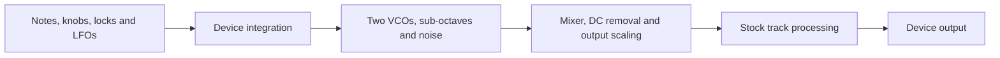

# Architecture

OB-1 supplies an oscillator section to a device's existing audio engine. It does not replace the
device's filter, amplitude envelope or effects with models of the Oberheim equivalents.

## Signal flow and ownership

| Boundary | Responsibility |
|---|---|
| Shared sound engine | Oscillator state, waveshapes, sync, cross modulation, sub-octaves, noise, mixing and sample output. It has no firmware or UI dependencies. |
| Device integration | Parameter decoding, pitch conversion, voice lifetime, firmware callbacks, output-format matching and UI. |
| Elekloader Core and machine-pages | Machine registration, firmware exports, render dispatch and the custom SRC/LFO page behavior. |
| Stock firmware | Sequencing, parameter locks, LFO updates and the track processing surrounding the oscillator source. |

Digitakt mk1 is the implemented target. Digitone is a scaffold: its successful placeholder tasks do
not establish a working port. A new target must establish its own parameter, pitch, envelope, timing
and output contracts rather than inheriting Digitakt firmware assumptions.

## Timing and state

Audio runs at 48 kHz in blocks of 32 samples: 1,500 blocks per second, about 667 microseconds per block.
Digitakt has one retained OB-1 voice state per track, for eight tracks. It reads current parameters
once per block; sync and cross modulation interact sample by sample inside the block.

The render callback replaces the selected tracks' audio after stock playback and before stock
overdrive. It runs at interrupt level. Its work must be bounded and must not allocate memory, perform
I/O or wait for UI work. Tracks using another machine retain their stock audio blocks.

Voice state is initialized on first use. Trigs do not restart oscillator phase. Once the AMP envelope
has reached exactly zero and no trig starts the voice, sound generation is skipped and its block is
cleared. An oscillator mixed off is skipped unless modulation still needs it. Retained phase therefore
approximates free-running analog oscillators; it does not advance through all silent time.

## Parameters and saved sounds

Machine ID **69** identifies OB-1 in saved Digitakt sounds. Its identity and the meaning of saved
parameter values are compatibility boundaries. Changing them requires an explicit compatibility plan.

The eight SRC controls use the stock SLICE parameter layout so the existing lock and LFO machinery
can act on them. Firmware knob values have eight fractional bits (8.8 fixed point); oscillator
settings use decoded integers. Display labels are not an alternative storage format.

| Control | Meaning at the sound-engine boundary |
|---|---|
| TUNE | Applied to the trig's note by the device's pitch conversion. |
| FRQ2 | Raw integer 0–63 represents −32 to +31 semitones relative to VCO1; 32 is unison. |
| WAV1/WAV2 | 0–63 is triangle to saw; 64–127 is narrow pulse to square. |
| MOD | Four equal zones across 0–127 select OFF, SYNC, XMOD, BOTH. |
| MIX1/MIX2 | Nine equal zones across 0–127 select the FUND/OCT combinations below. |
| NOIS | Three equal zones across 0–127 select OFF, −3DB, ON. |

Mixer knob travel follows this order. The decoded mixer value is three times the fundamental's
level plus the octave's level, with OFF = 0, −3DB = 1 and ON = 2. Host rendering accepts that decoded
value directly, not the firmware knob position.

| Zone, low to high | FUND/OCT | Decoded value |
|---|---|---|
| 0 | OFF/OFF | 0 |
| 1 | −3DB/OFF | 3 |
| 2 | ON/OFF | 6 |
| 3 | ON/−3DB | 7 |
| 4 | ON/ON | 8 |
| 5 | −3DB/−3DB | 4 |
| 6 | −3DB/ON | 5 |
| 7 | OFF/−3DB | 1 |
| 8 | OFF/ON | 2 |

Switching a track to OB-1 sets both saws in unison, VCO1 FUND ON, VCO2 FUND −3DB, subs and noise OFF,
and modulation OFF. Defaults must reach both the saved sound and the live engine. Updating only one
can leave the displayed or reloaded sound different from the sound being played.

## Pitch, pages and dependencies

Digitakt uses its firmware pitch table to preserve the stock relationship between notes and TUNE.
The host renderer uses equal-tempered frequencies with A4 = 440 Hz. Both supply oscillator phase
increments; host pitch calculations do not prove exact device pitch behavior.

The SRC page borrows the stock parameter machinery while supplying names, text and custom graphics.
Controls that would otherwise open a sample list or use unsuitable stock ranges need explicit page
behavior. Page defaults alone do not replace the machine-switch initialization described above.

Digitakt integration requires the Core 3.0 interface and machine-pages with custom knob drawing
(1.1 or newer). Core interface compatibility is distinct from the Core version selected for a build.
See the pinned SDK's [Core reference](../vendor/elekloader/mods/core/README.md) and
[machine-page reference](../vendor/elekloader/mods/machine-pages/README.md) for the framework contracts.
