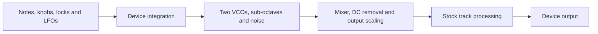

# Architecture

OB-1 supplies an oscillator section to a device's existing audio engine. It does not replace the
device's filter, amplitude envelope or effects with models of the Oberheim equivalents.

## Signal flow and ownership

| Boundary | Responsibility |
|---|---|
| Shared sound engine | Oscillator state, waveshapes, sync, cross modulation, sub-octaves, noise, mixing and sample output. It has no firmware or UI dependencies. |
| Device integration | Parameter decoding, pitch conversion, voice lifetime, firmware callbacks, output-format matching and UI. |
| Elekloader Core and machine-pages | Machine registration, firmware exports, render dispatch and the custom SRC/LFO page behavior. |
| Stock firmware | Sequencing, parameter locks, LFO updates and the track processing surrounding the oscillator source. |

Digitakt mk1 is the implemented target. Digitone is a scaffold: its successful placeholder tasks do
not establish a working port. A new target must establish its own parameter, pitch, envelope, timing
and output contracts rather than inheriting Digitakt firmware assumptions.

## Timing and state

Audio runs at 48 kHz in blocks of 32 samples: 1,500 blocks per second, about 667 microseconds per block.
Digitakt has one retained OB-1 voice state per track, for eight tracks. It reads current parameters
once per block; sync and cross modulation interact sample by sample inside the block.

The render callback replaces the selected tracks' audio after stock playback and before stock
overdrive. It runs at interrupt level. Its work must be bounded and must not allocate memory, perform
I/O or wait for UI work. Tracks using another machine retain their stock audio blocks.

Voice state is initialized on first use. Trigs do not restart oscillator phase.
Within an active voice, both oscillators and sub-octaves advance continuously, including
while their mixer outputs are OFF. Selected sync and cross modulation keep running independently
of output levels. Mixer changes therefore preserve oscillator phase and band-limiting history.

Live notes on an OB-1 track use last-note priority. Releasing the newest note recalls the most
recent note still held, with its original velocity and trigger settings, through the stock note-on
path (including envelope retriggering). Releasing an older held note leaves the current note playing.
The stock held-note counts handle repeated presses of the same pitch; clearing those counts also
discards recalled holds. Each track retains up to all 128 MIDI pitches independently. Sequencer playback and
sample preview retain their stock paths; held-note bookkeeping runs only on live note events.

## Parameters and saved sounds

Machine ID **69** identifies OB-1 in saved Digitakt sounds. This two-page parameter mapping deliberately
replaces the earlier combined controls; older sounds, locks and LFO assignments are not migrated.

There are fifteen logical SRC values. The performance page has two rows of coarse tuning, fine tuning,
wave family and waveform shape, one row per oscillator. The mixer page has independent fundamental and
sub-octave levels for each oscillator, independent cross-modulation and sync switches, and noise level.
Its fourth knob is blank. See the [playing controls](../README.md#playing-it) for their positions.

| Control | Meaning at the sound-engine boundary |
|---|---|
| FRQ1/FRQ2 | Raw integer 0–63 represents −32 to +31 semitones from the played note, independently for each VCO. |
| FIN1/FIN2 | Raw 8.8 values span −50 to +50 cents, with exact zero at 64 and fractional modulation retained. |
| TYP1/TYP2 | Raw integer 0 selects saw family; 1 selects pulse family. Fractional modulation switches at 0.5. |
| WAV1/WAV2 | Raw integer 0–63 traverses triangle→saw or narrow pulse→square within the selected family. |
| FND1/FND2, OCT1/OCT2, NOIS | Raw integer 0–42 is OFF, 43–85 is −3 dB, 86–127 is ON. |
| XMOD, SYNC | Raw integer 0–63 is OFF, 64–127 is ON; the two switches are independent. |

Firmware knob values have eight fractional bits (8.8 fixed point). Fine tuning converts those
fractions to pitch directly: the distance from 64 divides by 64 below the center and by 63 above
it, scaled to half a semitone. Both endpoints are therefore exact. Coarse tuning and waveform position
use decoded integers, retaining the engine's existing calibrated waveform positions.

The integration translates separate family/shape and fundamental/sub-octave controls to the shared
engine's compact representations. The engine's wave index remains 0–63 for saw and 64–127 for pulse;
its oscillator mix remains three times the fundamental level plus the sub-octave level, where OFF,
−3 dB and ON decode to 0, 1 and 2. Cross modulation and sync remain independent routing bits.
This translation does not change waveform calibration, source gains or maximum available levels.
The host renderer and DSP benchmark continue to accept those compact sound-engine controls.

Switching a track to OB-1 sets both saws to the played note with FIN1 at zero and FIN2 at +2.4 cents,
VCO1 FUND ON, VCO2 FUND −3DB, subs and noise OFF, and modulation OFF. This fresh-patch detune leaves
the fine controls' neutral defaults at zero and does not change loaded sounds. Initial values must
reach both the saved sound and the live engine. Updating only one can leave the displayed or reloaded
sound different from the sound being played.

## Incoming MIDI controls

On an OB-1 audio track, CC 16–30 address the fifteen source controls in logical order:

| CC | Control | Integer values |
|---|---|---|
| 16 / 20 | FRQ1 / FRQ2 | 0–63, with unison at 32 |
| 17 / 21 | FIN1 / FIN2 | 0–127, with exact zero at 64 |
| 18 / 22 | TYP1 / TYP2 | 0 saw, 1 pulse |
| 19 / 23 | WAV1 / WAV2 | 0–63 within the selected family |
| 24 / 27 | FND1 / FND2 | 0–42 OFF, 43–85 −3 dB, 86–127 ON |
| 25 / 28 | OCT1 / OCT2 | 0–42 OFF, 43–85 −3 dB, 86–127 ON |
| 26 / 29 | XMOD / SYNC | 0–63 OFF, 64–127 ON |
| 30 | NOIS | 0–42 OFF, 43–85 −3 dB, 86–127 ON |

CC **9**, with any value, requests a full sound-engine voice reset on the addressed OB-1 audio
track. The next active audio block restarts both VCOs, sub-octaves, edge-correction history,
DC-removal and smoothing history, and the track's fixed noise seed. A silent track keeps the
request until it renders again. Repeated requests before that block coalesce. The command does
not change saved controls or restart the stock AMP envelope, filters or effects. Resetting a
sounding voice can produce a click; use it explicitly when preparing repeatable captures.

Diagnostic builds optionally include CC **12**, which with any value starts the fixed 23-second diagnostic DSP scenario on the addressed
OB-1 audio track at the next render block. It initializes the voice once, then schedules the pitch,
source controls and DSP gates on exact 32-sample boundaries. Repeating CC 12 restarts the scenario;
CC 9 cancels it and resets the voice. Switching to another machine also cancels it. The scenario
returns to the normal live controls after 23 seconds and never writes saved parameters. Normal
firmware builds exclude the scenario code and leave CC 12 unassigned.

Prepare a held stock AMP and a silent source before triggering. During the scenario, local source
controls and pitch override the live values; rests gate the DSP and hold its state. The stock note,
AMP envelope, filters and effects remain fixed. This diagnostic therefore measures repeatability of
the shared DSP through the device output, separately from MIDI dispatch and stock envelope retriggers.

Send raw integers; values above a control's maximum clamp to that maximum. MIDI uses the native
track receive channel, or the auto channel for the selected track, with RECEIVE CC/NRPN enabled.
The additional assignments apply only to audio tracks running machine 69. Other audio machines,
MIDI tracks and FX retain their native controller lookup, including the FX uses of CC 24–30.
This adds reception for the mixer controls; it does not assign outgoing MIDI feedback or new NRPNs.

## Pitch, pages and dependencies

Digitakt uses its firmware pitch table for both oscillators' independent note and tuning offsets.
Above the table range, octave scaling extends the device pitch to the shared 12 kHz ceiling.
The host renderer uses equal-tempered frequencies with A4 = 440 Hz. Both supply oscillator phase
increments; host pitch calculations do not prove exact device pitch behavior.

The SRC page borrows the stock parameter machinery while supplying names, text and custom graphics.
Controls that would otherwise open a sample list or use unsuitable stock ranges need explicit page
behavior. Machine-pages applies the declared defaults on a machine switch and updates the live engine;
the OB-1 switch callback clears its held-note state and applies the fresh-patch FIN2 detune.

Both pages read the native processed values, including locks and LFO modulation. The mixer controls
occupy the seven additional sound slots supplied by machine-pages. Version-4 saved sounds require
compatible custom firmware; older machine-pages and stock firmware cannot reload that format correctly.

Digitakt integration requires the Core 3.0 interface and machine-pages 1.2 for the two-page UI.
Core interface compatibility is distinct from the Core version selected for a build.
See the pinned SDK's [Core reference](../vendor/elekloader/mods/core/README.md) and
[machine-page reference](../vendor/elekloader/mods/machine-pages/README.md) for the framework contracts.
