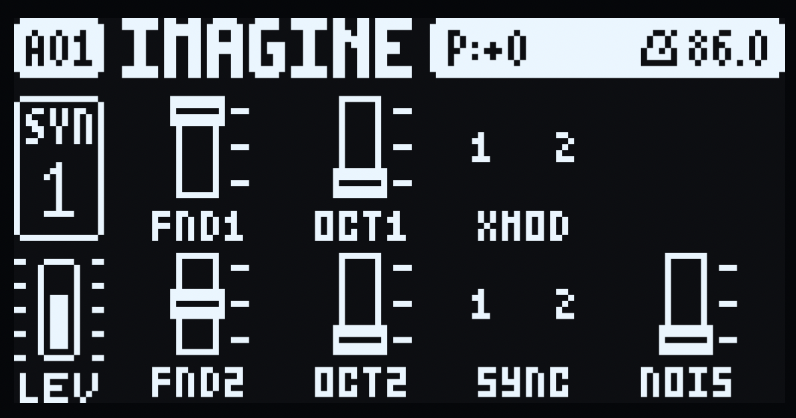
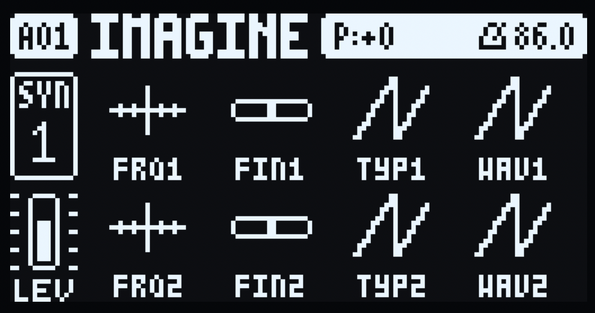

# OB-1 for the Digitone mk1 / Keys

The Oberheim OB-1's oscillator section as a Digitone mk1 / Keys machine
(id 69, `OB-1`), OS 1.44. Two VCOs (saw type, pulse type,
sub-octave), hard sync, cross mod, noise and the OB-1 mixer, through the
Digitone's own multimode filter, mixer, effects and AMP envelope, like FM.

A thin adapter over the shared oscillator engine: it only decodes its
sounds' SYN knobs into the engine's compact controls, supplies phase
increments and the output block, and leaves everything downstream to the
Digitone. The engine (`../../dsp/dsp.c`, `../../dsp/voice.c`) and the knob
icon art (`../digitakt/knobs.c`) are the Digitakt machine's, unchanged, so
the two devices sound from identical code, including the engine's
pitch-dependent source calibration and output smoothing. See
[the architecture](../../docs/architecture.md) for the device boundaries.

## Controls

The Digitakt machine's fifteen controls over two pages, on borrowed stock
SYN ranges (so p-locks, LFOs, MIDI CCs and presets all work untouched): no
custom parameters, no firmware sites.

| Page | Knobs | Controls |
| --- | --- | --- |
| SYN1 (MIX) | A-H | FND1, OCT1, XMOD, (blank), FND2, OCT2, SYNC, NOIS |
| SYN2 (OSC) | A-H | FRQ1, FIN1, TYP1, WAV1, FRQ2, FIN2, TYP2, WAV2 |

| Control | What it does |
| --- | --- |
| FRQ1, FRQ2 | VCO1/VCO2 coarse pitch, -32 to +31 semitones, 2 detents each (64 = 0) |
| FIN1, FIN2 | VCO1/VCO2 fine tune, about +-50 cents (64 = 0) |
| TYP1, TYP2 | VCO1/VCO2 wave family: SAW below the midpoint, PULS above |
| WAV1, WAV2 | VCO wave within the family: triangle to saw, or narrow pulse to square |
| FND1, FND2 | VCO1/VCO2 fundamental: ON, -3 dB or OFF (3 zones) |
| OCT1, OCT2 | VCO1/VCO2 sub octave: ON, -3 dB or OFF (3 zones) |
| XMOD | VCO2's saw on VCO1, +-3.92 octaves: ON/OFF |
| SYNC | VCO2 hard-syncs to VCO1: ON/OFF |
| NOIS | Noise OFF, -3DB, ON (3 zones) |

OSC sits on SYN2 because SYN1's stock slots are FM's narrow ranges (ALGO
is 0-7, too coarse for FRQ1's +-32 semitones); MIX sits on SYN1, whose
every slot still has enough states for its control. Each page redraws as
four columns by two rows, each cell the Digitakt knob icon over a centred
label.

## Screenshots

|  |  |
| --- | --- |

A track switched to OB-1 starts as two saws in unison (VCO1 FUND ON,
VCO2 FUND at -3 dB), the Digitakt default. Both VCOs run freely between
notes, as the OB-1's do. A knob's value shows in place of its label just
after its encoder turns; turn popups carry it too. P-locks show per step
in GRID/STEP record (slot-indexed); turn popups and LFO destination lists
keep FM names (companion limit).

A FUNC+turn resets a knob to the value a switch would set, in the sound
or, with a step held in GRID/STEP record, that step's lock. Left to the
stock reset it would write the borrowed stock record's default instead,
which is FM's, not OB-1's (FRQ1 would drop to -32 semitones, FIN1 to -25
cents, TYP1 to PULS), so the adapter writes OB-1's own default and takes
the turn (`overlay.c`).

Re-pick the machine after flashing: the knob map changed during
development, so a sound saved with an earlier build may point at a
different control now.

Polyphony: newest-wins per track (2 voices each, up to 8 total — tracks
never choke each other); releases free immediately; the UI-tick reap
clears unobserved ends. System LFOs reach all fifteen used SYN slots;
FILTER/AMP destinations apply downstream and are ignored in the render, as
on FM voices.

## Signal path

Per voice/block: knobs+LFO → `ob1_knobs` (pitch per VCO from
`dnm_phase_inc` over note+FRQ+FIN) → `ob1_voice_render` (Q1.31) →
companion AMP envelope + velocity. The engine's block is written unscaled,
exactly as the Digitakt machine writes it, so the two devices match for
the same knobs; a single oscillator at ON peaks about at `DNM_PEAK` at
mid pitches, and the engine attenuates sources as pitch rises, after the
reference's measured source response. Flags 0: the companion owns AMP and
velocity. Muted sources only drop their output gain: both VCOs, their
sub-octaves and the selected modulation paths keep advancing, as the
OB-1's free-running oscillators do (shared `voice.c`). The fuse constant
`OB1_TRACK_VOICES` is pending fwcheck/hardware measurement (see
`EVIDENCE.md`).

## Build and run (developers only)

Builds use the repo's [mise](https://mise.jdx.dev) tasks and need the
ColdFire cross-toolchain (`m68k-elf-`), this repo's `vendor/elekloader`
checkout and your own stock Digitone OS 1.44 file. Copy it into `firmware/`
as `Digitone_*.syx`; `DIGITONE_STOCK` in `mise.toml` names it. From the repo
root:

```sh
mise run build:digitone      # core-dn1 + machines + OB-1 into out/dn1.44/
mise run firmware:digitone   # writes out/ob1-dn-1.44-<version>.syx
mise run emu:digitone        # opens it in digiemu
mise run knobs:digitone      # prints the SRC page's knob art as text
```

The unqualified tasks dispatch to both devices, so `mise run firmware`
builds the Digitakt and Digitone images. Stock `.syx` files are build
inputs only and are never committed.

Host DSP checks without firmware (also run by `mise run test`):

```sh
python3 tools/ob1_digitone_host_test.py
```

## Source layout

* `../../dsp/dsp.c`, `../../dsp/voice.c` (+ headers) — the shared sound
  engine, also used by the Digitakt machine. Device-specific behavior
  stays in this adapter, never in the engine.
* `../digitakt/knobs.c` (+ header) — the SRC page's knob icon art, shared
  with the Digitakt machine and drawn pixel for pixel.
* `param.h` — knob index/range tables and raw knob values to OB-1
  settings, shared by the engine and the overlay so the display always
  matches the sound.
* `engine.c` — machine descriptor, the fifteen-control knob table, render,
  per-track fuse and LFO plumbing.
* `overlay.c` — full SYN1 (MIX) and SYN2 (OSC) redraws (tick/draw/key/enc)
  with the knob icons over centred labels (value in place of the label
  just after its encoder turns), and the FUNC+turn reset to OB-1's
  defaults.
* `pages.s` — empty anchor; no page-constructor patches are needed
  because all knobs borrow stock ranges.
* `mod.json` — device `digitone-mk1`, machine 69, zero sites. The only
  firmware address named is the showing key (`KEYVAR_AT`, the OS 1.44
  address); pattern/project come from core-dn1 exports.

## Status and license

Host harness green, builds/lints/patches verified for 1.44, and
tested on hardware (sound, both pages, turns, locks, transport, menus and
the FUNC+turn reset; see `EVIDENCE.md`). Emulator screenshots of both
pages are included above. GPL-2.0-or-later, unofficial, not affiliated
with Elektron or Oberheim.
